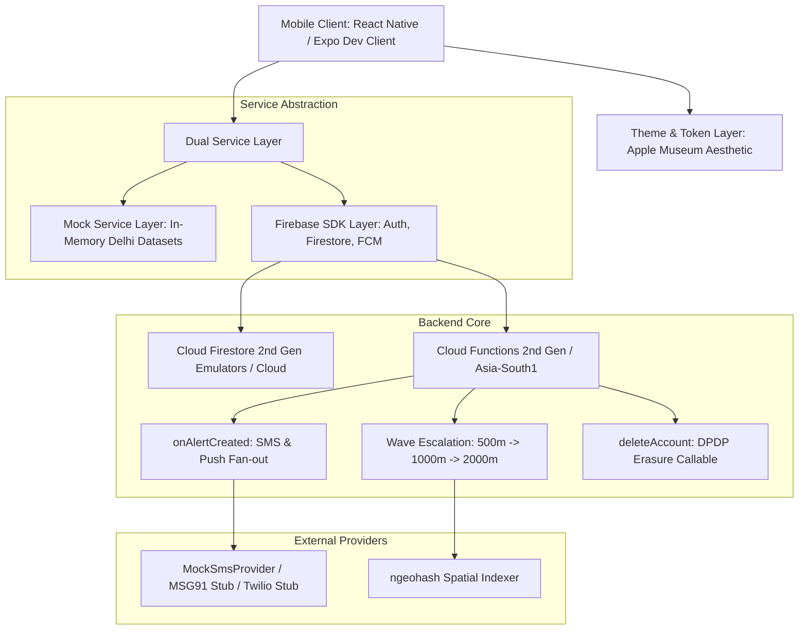

# Rahat (राहत) — Privacy-First Women's Personal Safety App

> *"A step towards freedom. A movement towards safety."*  
> *"आज़ादी की ओर एक कदम। सुरक्षा की ओर एक आंदोलन।"*

[-blue.svg)](#)
[-black.svg)](#)
[](#)
[-brightgreen.svg)](#)
[](#)

---

## 1. Overview & Launch Geography

**Rahat (राहत)** is a privacy-first, community-powered personal safety app built for women in **Delhi NCR** (launch corridors: Connaught Place, Janpath, Mandi House, Hauz Khas Village, Saket, and DLF Cyber City Gurgaon).

### Positioning & Legal Disclaimer
> [!IMPORTANT]
> **Rahat complements official emergency services — it NEVER replaces them.**  
> In any life-threatening situation or emergency, dial **112 (ERSS National Emergency)** or **1091 (Delhi Police Women Helpline)** immediately.

---

## 2. Non-Negotiable Safety Principles

1. **Prevention Over Reaction:** Explainable, transparent safety scores (5–98 scale), well-lit walking corridors, and community hazard alerts before harm occurs.
2. **Zero Crime Profiling:** Safety scores use *strictly* physical infrastructure variables (street lighting lux, CCTV density, verified safe haven proximity, time-of-day footfall, and corroborated hazards). Scores **never** factor neighborhood demographics, average income, religion, or caste.
3. **Privacy First (DPDP Act 2023):** Location is acquired *only* with explicit user consent and *only* during an active journey, an active distress SOS, or while the foreground map is actively open. No silent background tracking. Public profiles and private PII are partitioned in separate database paths.
4. **Truth in Dispatch:** The app never falsely displays "Sent". Per-contact states reflect verified reality: `pending` → `sent` | `failed` | `offline_fallback_prepared` | `user_sent_via_sms`.
5. **No False Alarms:** Route deviation (90m buffer, 3 consecutive fixes) **never** triggers an automated call to police or automated SOS dispatch. A human decides.
6. **No Automated 112 Dialing:** Emergency hotline buttons prefill the native OS phone dialer (`tel:112`, `tel:1091`), and the user explicitly taps Call.

---

## 3. Architecture & System Design



---

## 4. Quickstart & Local Development

### Prerequisites
- **Node.js:** v20.x or higher
- **Java:** JDK 17+ (required for Firebase Local Emulator Suite)
- **Expo CLI:** `npx expo`

### Setup Instructions

```bash
# 1. Install root Expo mobile dependencies
npm install

# 2. Run TypeScript strict type-check (zero implicit any)
npm run type-check

# 3. Run full Jest test suite
npm test

# 4. Install Cloud Functions dependencies and build
cd functions
npm install
npm run build
npm test
cd ..
```

### Running with Firebase Local Emulator Suite

```bash
# Start Firestore, Auth, Functions, and Emulator UI
firebase emulators:start
```
- **Emulator UI:** `http://localhost:4000`
- **Firestore Port:** `8080`
- **Auth Port:** `9099`
- **Functions Port:** `5001`

### Running Mobile App

```bash
# Start Expo development client (recommended for native modules like expo-location, expo-sms)
npx expo start --dev-client

# Or run on web/simulator
npx expo start
```

### Service Mode Configuration (`SERVICE_MODE`)
In `src/services/index.ts`:
```typescript
export type ServiceMode = 'firebase' | 'mock';
export const SERVICE_MODE: ServiceMode = 'mock'; // Toggle to 'firebase' for live emulator
```
When running in `'mock'`, the app runs completely standalone with Delhi NCR seed datasets (Connaught Place, Mandi House, Hauz Khas Village, Saket, Cyber City).

---

## 5. Verified vs. Simulated Audit Matrix

| Feature | Verified in Code & Tests | Simulated in Local Dev / Demo Mode |
|---|---|---|
| **Safety Risk Engine** | Point-by-point itemized score calculation, time-band penalties, corroboration weighting, zero profiling. | Live streetlight sensor telemetry (uses Delhi NCR seed lux levels). |
| **Deviation Engine** | Spherical cross-track distance, 90m buffer, 3-fix threshold, accuracy > 75m ignored, 120s cooldown. | GPS signal loss and off-route movement (via Dev Simulation Harness). |
| **Emergency SOS Countdown** | 3s / 5s / 10s cancelable countdown, instant "Send Now", haptic feedback per second. | Hardware physical vibration on emulators (gracefully falls back if unavailable). |
| **Dispatch & Receipts** | Real per-contact receipts (`sent`, `pending`, `offline_fallback_prepared`, `user_sent_via_sms`). | Cellular carrier delivery confirmations (simulated latency). |
| **Offline SMS Fallback** | Native SMS composer prefill with Google Maps link (`expo-sms`), user confirmation tracking. | Background SMS transmission without user intervention (OS restricted). |
| **Community Rescue Network** | Wave 1 (500m), Wave 2 (1000m/60s), Wave 3 (2000m); first-acceptance-wins race logic. | Push dispatch to active volunteer devices in area (simulated via in-memory engine). |
| **Safe-Code / Duress-Code** | 4-digit PIN verification, covert duress code (`safeCode + 1`) notifying police discreetly. | Live dispatch center integration (112 ERSS API integration stub). |
| **DPDP Act 2023 Erasure** | `deleteAccount` callable, purge of private PII subcollections, report author anonymization. | Real UID deletion across production Firebase Auth. |
| **Bluetooth LE Wearable** | Telemetry tracking, RSSI, battery percentage, panic button listener. | Physical BLE hardware pairing (simulated via `MockWearableService`). |

---

## 6. Statutory Hotlines & Regulatory Notices

### Official Verified Emergency Helplines (Delhi NCR)
- **112:** National Emergency Response Support System (ERSS Police / Fire / Ambulance)
- **1091:** Delhi Police Women in Distress Helpline
- **7827170170:** National Commission for Women (NCW) WhatsApp Support
- **1930:** National Cyber Crime Reporting Portal Helpline
- **011-23317004:** Delhi Police Special Cell for Women & Children (Nanakpura)
- **One-Stop Crisis (Sakhi) Centres:** Integrated medical, legal, and counseling shelters across Delhi districts.

### Indian Cellular SMS Regulation (TRAI DLT)
Sending automated cellular SMS in India requires compliance with Telecom Commercial Communications Customer Preference Regulations (TCCCPR). Any production SMS provider (such as MSG91 or Twilio) requires:
1. Registration of the Principal Entity with a Telecom Service Provider (DLT portal).
2. Approved Sender Header (e.g. `RAHATS`).
3. Registered and approved Template IDs matching the exact message syntax.

---

## 7. License & Attribution

Developed with privacy, dignity, and safety at its core. Distributed for community safety and public good.
